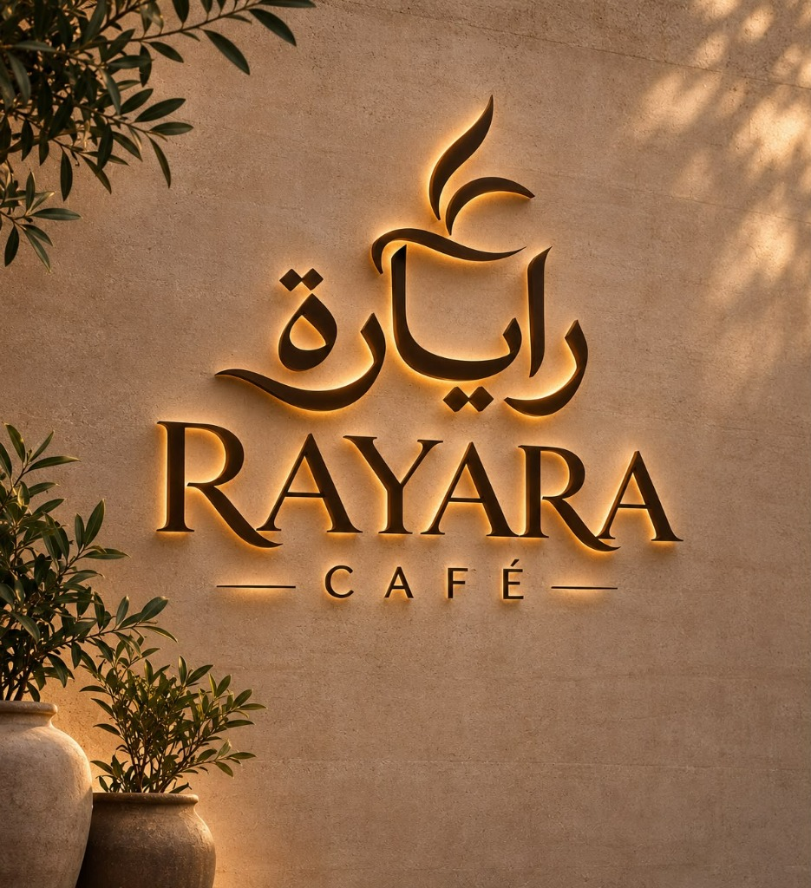

# 🌿 Rayara Café — Play & Dine

A luxury Mediterranean-inspired mobile-first QR café experience platform: digital menu, 20-slice physics-based spin wheel, instant games, email verification with Resend, 24-hour daily play limits, staff redemption counter, and owner business analytics.



---

## ✨ Features

- **Email OTP Authentication**: Passwordless customer login via 6-digit email codes delivered via [Resend API](https://resend.com) (or SMTP fallback). Free transactional email delivery with zero SMS gateway costs.
- **24-Hour Fair Play Enforcement**: Strict 24-hour cooldown per email address across all games. Enforced at the database row-lock level (`select_for_update()`) to prevent multi-tab/multi-device exploitation.
- **20-Slice Interactive Spin Wheel**:
  - Physics-based smooth deceleration curve (`cubic-bezier(0.15, 0.9, 0.2, 1.0)`) and animated needle-ticking.
  - Slices: 10× 1%, 3× 2%, 2× Unlucky (0%), 1× 5%, 1× 8%, 1× 12%, 1× 15%, 1× 25% (Ultra-Rare Gold Star at 0.2% probability).
  - Unlucky landing handled gracefully with encouraging messaging.
- **Alternative Game Modes**:
  - Mystery Scratch Card
  - Food Quiz
- **Digital Café Menu**: Browse shawarma, grills, snacks, beverages, and desserts.
- **Staff Redemption Counter (`/staff`)**: Validate customer discount coupons against bill totals with instant percentage calculation and audit logging.
- **Owner Business Analytics (`/owner`)**: Live metrics on unique customer acquisition, total plays, redemptions, and revenue discounts given.
- **Backlit Bronze & Travertine Aesthetic**: Designed from the illuminated architectural signage with warm amber halo glows, limestone textures, and olive foliage accents.

---

## 📁 Project Structure

```
├── backend/                  # Django REST Framework API
│   ├── config/               # Settings, URLs, and WSGI entry points
│   ├── core/                 # Models, Views, Serializers, Mailer, Admin
│   │   ├── mailer.py         # Resend API & SMTP transactional email engine
│   │   ├── models.py         # Customer, CustomerOTP, GameAttempt, Coupon, Redemption
│   │   ├── tests.py          # Automated test suite
│   │   └── management/       # Demo seeder for 20-slice rewards and accounts
│   ├── Dockerfile
│   └── requirements.txt
├── frontend/                 # Next.js 15 (App Router), React 19, Tailwind CSS
│   ├── app/                  # Main page, staff portal, owner dashboard
│   ├── lib/api.ts            # Typed client API layer with reverse-proxy rewrites
│   ├── public/               # Rayara logo and signage assets
│   ├── tailwind.config.ts    # Rayara bronze & amber theme configuration
│   └── next.config.ts        # Trailing slash handling and backend API rewrites
├── docker-compose.yml        # PostgreSQL + Django production-ready compose
├── .env.example              # Environment variables template
└── QR-PRINT-INSTRUCTIONS.txt # Guidance for printing table QR codes
```

---

## 🚀 Quickstart

### Prerequisites
- Python 3.11+
- Node.js 20+ & npm
- (Optional) Docker Desktop

### 1. Backend Setup (Django)

```bash
cd backend

# Create virtual environment (optional but recommended)
python -m venv .venv
# Windows: .venv\Scripts\activate | macOS/Linux: source .venv/bin/activate

# Install dependencies
pip install -r requirements.txt

# Run migrations and seed initial demo data
python manage.py migrate
python manage.py seed_demo

# Start the Django development server
python manage.py runserver 0.0.0.0:8000
```

Seeded default credentials:
- **Django Superuser / Owner**: `admin` / `admin123`
- **Staff Counter**: `staff1` / `staff123`

### 2. Frontend Setup (Next.js)

```bash
cd frontend

# Install dependencies
npm install

# Start Next.js development server
npm run dev
```

Open [http://localhost:3000](http://localhost:3000) in your browser.

---

## 🔑 Environment Variables

Copy `.env.example` to `.env` in the root directory:

```env
DEBUG=1
SECRET_KEY=your-django-secret-key
ALLOWED_HOSTS=localhost,127.0.0.1
CORS_ALLOWED_ORIGINS=http://localhost:3000

# Resend API for Real Email OTP Delivery
RESEND_API_KEY=re_your_api_key_here
RESEND_FROM_EMAIL=Rayara Café <onboarding@resend.dev>
```

> **Testing Resend in Free Tier**:
> In Resend's free sandbox (`onboarding@resend.dev`), emails can be delivered to the email address registered with your Resend account or `delivered@resend.dev`. When testing with other unverified domains, the development UI automatically displays a **⚡ Test Code** quick-fill button.

---

## 📱 URLs & Portals

| Portal | URL | Notes |
| :--- | :--- | :--- |
| **Customer App** | `http://localhost:3000` | Sign in with email, spin the wheel, view saved coupons |
| **Staff Redemption** | `http://localhost:3000/staff` | Sign in as `staff1` / `staff123` to redeem coupons |
| **Owner Dashboard** | `http://localhost:3000/owner` | Sign in as `admin` / `admin123` to view analytics |
| **Django Admin** | `http://localhost:8000/admin/` | Direct model inspection and user management |

---

## 🧪 Testing

Run the Django unit test suite:

```bash
python backend/manage.py test core
```

---

## 📄 License

Proprietary © Rayara Café. All rights reserved.
